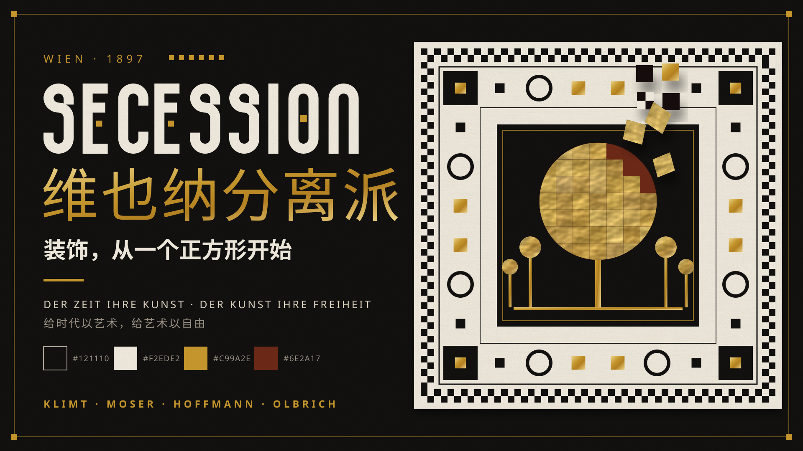
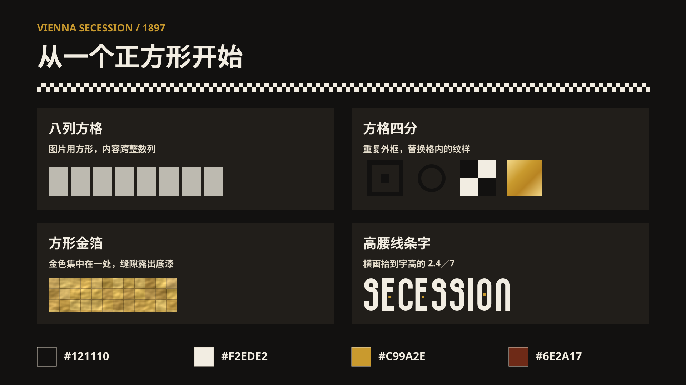
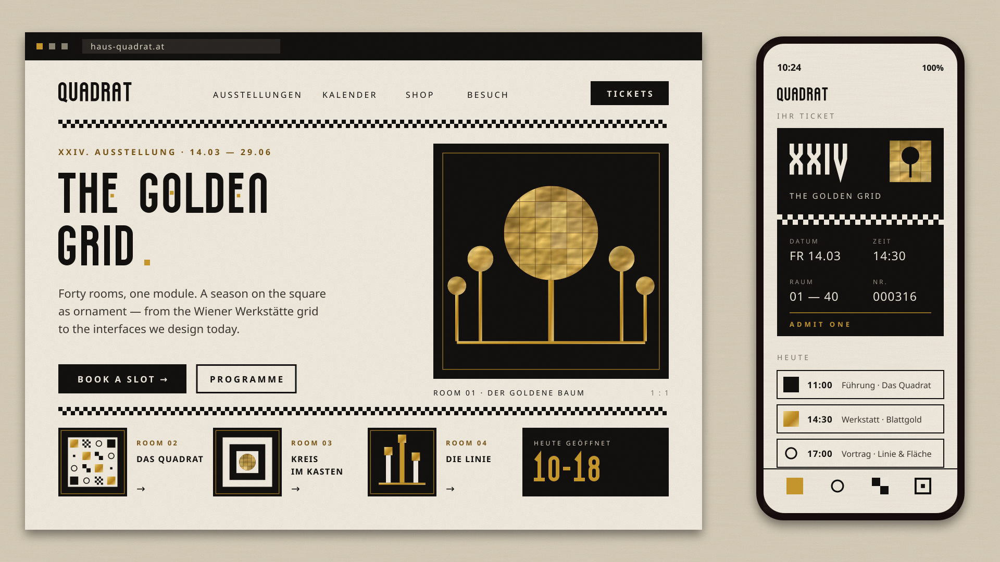

# Style 030 · Vienna Secession

The Vienna Secession was founded in 1897. Gustav Klimt was its first president. Founding members included Kolo Moser, Josef Hoffmann and Joseph Maria Olbrich. [Vienna Secession association](https://secession.at/en/association_of_visual_artists_vienna_secession)

The 19.5-second film opens on a gilded tree. Gold leaves settle into the canopy as the camera dips toward the table, orbits the panel and rises overhead. The square panel splits into a grid and becomes a poster, a website, a ticket and magazine covers.

## Design with squares

Use eight columns to align text and images. Keep artworks square, buttons sharp-cornered and major sections separated by two rows of checks. Divide individual squares into quarters to build a pattern. Leave enough space between the patterned border and the focus of the composition.

Pair ink black and paper white for contrast, use gold at the focal point and let reddish-brown show in the seams between leaves. The hand-drawn lettering places crossbars about one-third down from the top.

## Website and mobile ticket

The exhibition website places its title and artwork in two four-column blocks. The mobile ticket uses the same palette, square corners and checkerboard. Gold is concentrated in the artwork or ticket seal.

[Making of](PROCESS.en.md) · [Rendering instructions](video/README.md) · [Download film](https://github.com/guanmo-ai/design-style/releases/tag/day-30)
