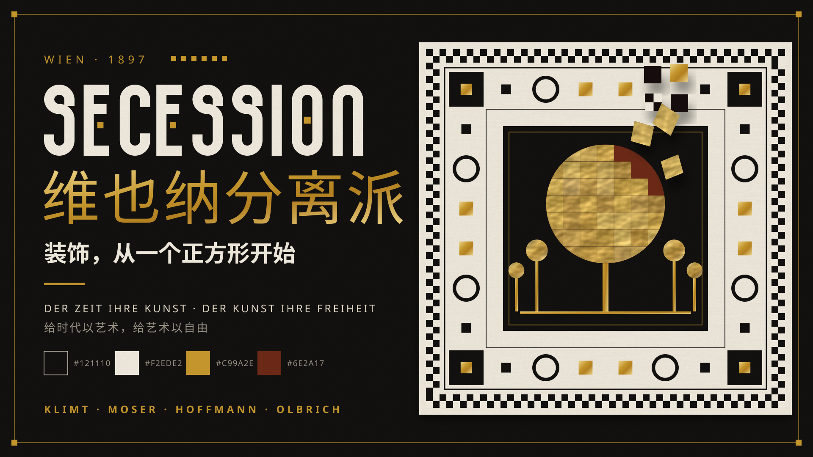
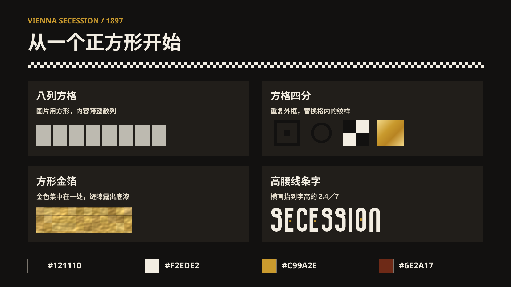
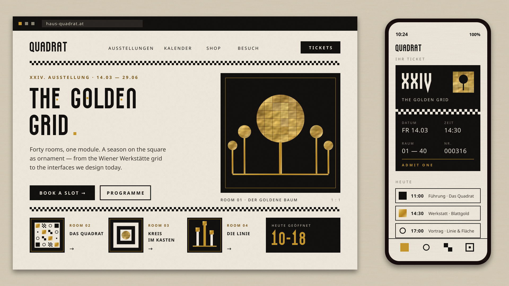

# 风格 030 · 维也纳分离派 Vienna Secession

维也纳分离派成立于 1897 年。克里姆特担任协会首任主席，创始成员还包括科洛曼·莫泽、约瑟夫·霍夫曼和约瑟夫·马里亚·奥尔布里希。[维也纳分离派协会](https://secession.at/en/association_of_visual_artists_vienna_secession)

这支 19.5 秒的短片从方板上的金树开始。金箔逐片落到树冠上，镜头从桌边绕过，再抬高到俯视角度。方板随后分成网格，变成海报、网页、门票和封面。

## 用方格组织版面

先用 8 列网格对齐文字和图片，再让图片跨整数列。把按钮和票面边角做成直角，用两行棋盘格分开大块内容。四分法适合局部纹样，外圈纹样与中间留白共同突出金树。

用墨黑 `#121110` 和纸白 `#F2EDE2` 建立明暗关系，把金色 `#C99A2E` 留给焦点，金箔缝隙用红褐色 `#6E2A17`。手绘英文标题把横画放在字高约三分之一处，窄字配宽留白。

## 网页与手机票券

展览网页把画作和标题放在两组四列里，手机票券保留相同的配色、直角和棋盘格。金色只集中在首屏画作或票面印章。

[制作过程](PROCESS.md) · [渲染入口](video/README.md) · [下载成片](https://github.com/guanmo-ai/design-style/releases/tag/day-30)
